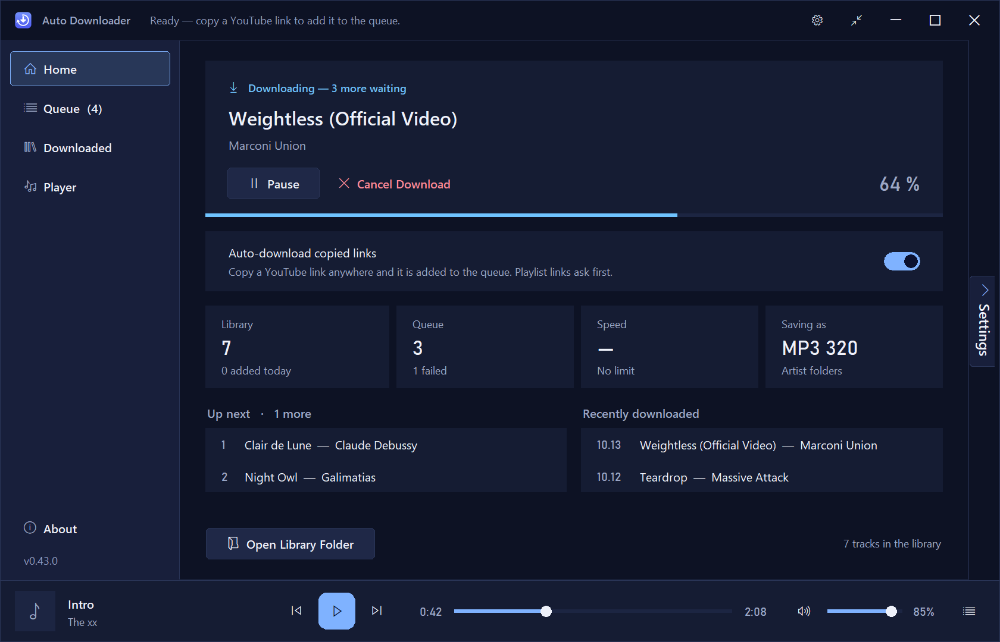
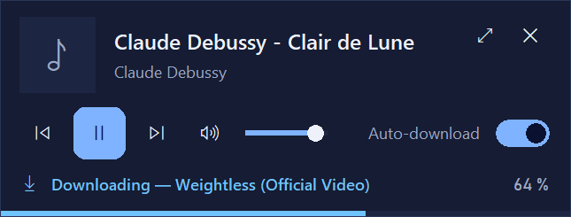
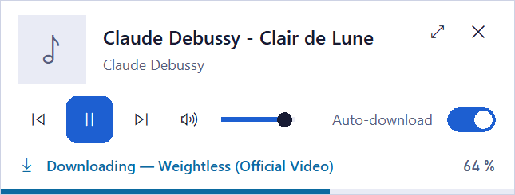
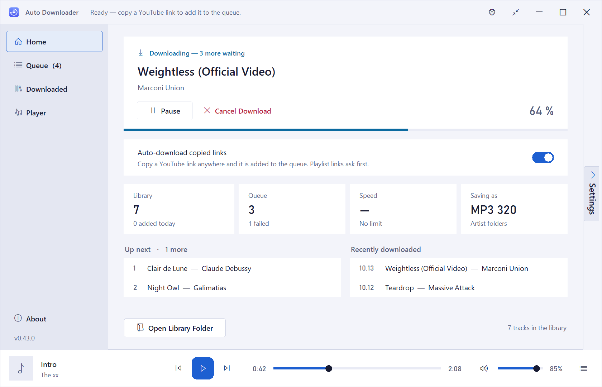
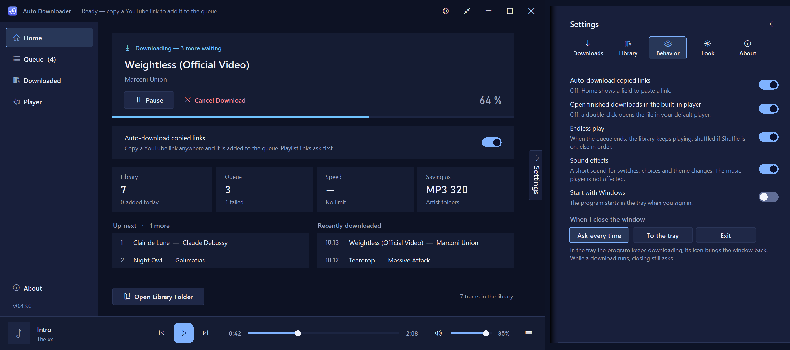
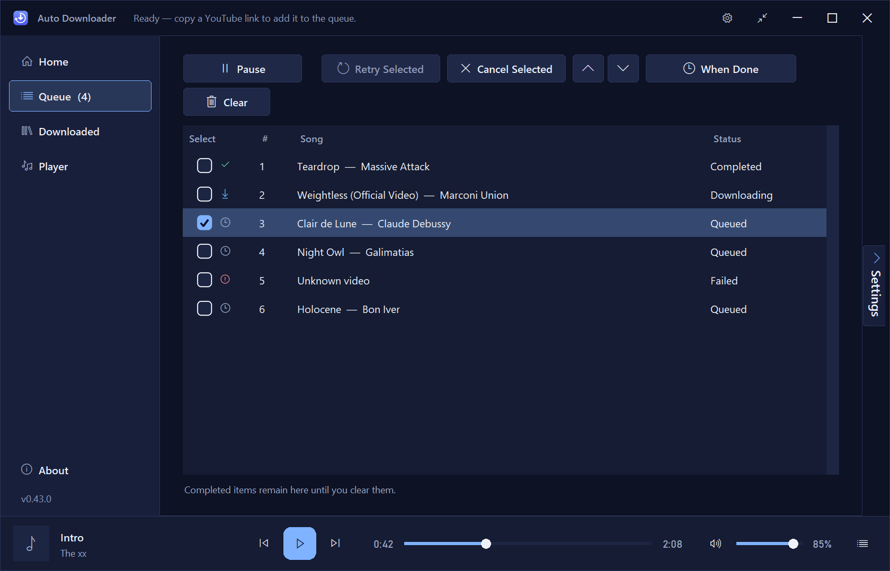
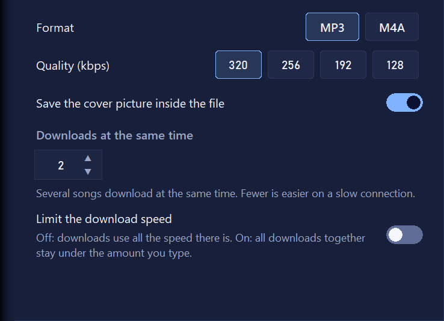
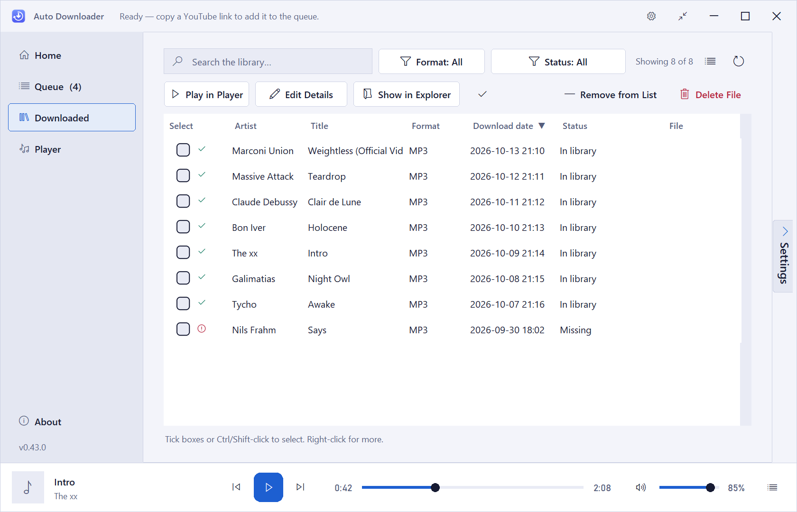
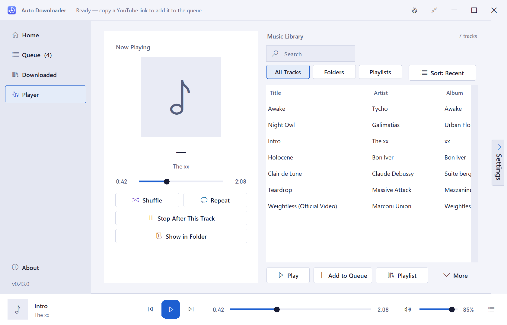

# Auto Downloader

**Copy a link. Get the song.**

A Windows desktop app that watches your clipboard and downloads copied YouTube links as tagged MP3 or M4A files, straight into your library. Built with DJs and collectors in mind.

**English** · [Türkçe](README.tr.md)

[**⬇ Download the latest release**](../../releases/latest)

---

## How it works

1. **Copy** a YouTube link from any browser, chat or note.
2. **Queue** – the track joins the queue and downloads in the background. A short sound confirms it.
3. **Library** – a tagged MP3 or M4A with cover art lands in your folder and shows up in *Downloaded* and the *Player*.

No website to visit, no converter to babysit.

## Highlights

### Automatic download
- A copied YouTube link is queued and downloaded by itself.
- Playlist links open a track picker first, so you choose what you want.
- Tracks already in your library or queue are recognized and skipped, so nothing downloads twice.

### Download without switching windows
- The app picks links up in the background; it never needs focus.
- **Mini view**: a small always-on-top player with now playing, download progress, the auto-download switch and volume.
- Closing the window can send the app to the tray, and downloads continue.
- Media keys control playback while another program is in front.

  
  &nbsp;
  

### Light and dark, your colors, your language
- Light, dark, or follow Windows.
- Six accent colors.
- Ten interface languages: Turkish, English, Dutch, German, Russian, Arabic, Chinese, Hindi, Spanish and Portuguese.

  
  &nbsp;
  

### Settings drawer
Open it from the *Settings* tab on the window edge or the gear in the title bar. Changes apply at once, and `Esc` closes it.

  

### Queue
- Run 1 to 10 downloads at once (default 2).
- Pause, resume, retry failed tracks, reorder waiting ones.
- Optional speed limit shared by all downloads.
- *When done*: sleep or shut down the PC, close the app, or send it to the tray.
- Closing the app never empties the queue; unfinished downloads continue at the next start.

  

## For DJs and collectors

Plain **MP3** and **M4A** files, tagged and organized.

- **Quality you choose:** 320, 256, 192 or 128 kbps. Cover art can be embedded in the file.
- **Tags that travel with the file:** title, artist, album, year and genre live in the file's own tags and can be edited in the app. Optionally write "Artist - Title" into the file name and title tag.
- **A folder structure you control:** one folder, by artist, by date, artist then date, or date then artist. One button reorganizes files you already have.
- **A library you can search, sort and drag from:** filter by format or status, drag tracks into other programs, no duplicates.
- **A player for auditioning tracks:** all tracks, folders or playlists; an up-next queue; shuffle, repeat, stop after this track, endless play; media keys.

  

  
  &nbsp;
  

> The tracks in the screenshots are sample data.

## Install

1. Open the [**Releases**](../../releases) page and download the Setup `.exe` from the latest release.
2. Run it and follow the installer. It includes everything the app needs (FFmpeg and the other components).
3. Start **Auto Downloader**. On first start, pick your language and theme.

**Windows SmartScreen:** the installer is not code-signed, so Windows may show "Windows protected your PC". Choose **More info → Run anyway** if you downloaded the file from this repository's Releases page.

**Requirements:** Windows 10 or newer (developed and tested on Windows 10).

## Use it responsibly

Auto Downloader is a personal tool. Only download content you have the right to download, and respect the terms of the services you use and the rights of artists. You are responsible for how you use it. This project is not affiliated with or endorsed by YouTube or Google.

## Third-party components

Auto Downloader uses [yt-dlp](https://github.com/yt-dlp/yt-dlp), [FFmpeg](https://ffmpeg.org) and other open-source components. See [THIRD_PARTY_NOTICES.md](THIRD_PARTY_NOTICES.md).

## License

© 2026 ofbyz. **All rights reserved.** This repository contains documentation and release binaries only.

## Support

If Auto Downloader is useful to you and you would like to support its development, message me on Instagram: [**@ofbyz**](https://www.instagram.com/ofbyz).

Bug reports and ideas are welcome in [Issues](../../issues).
