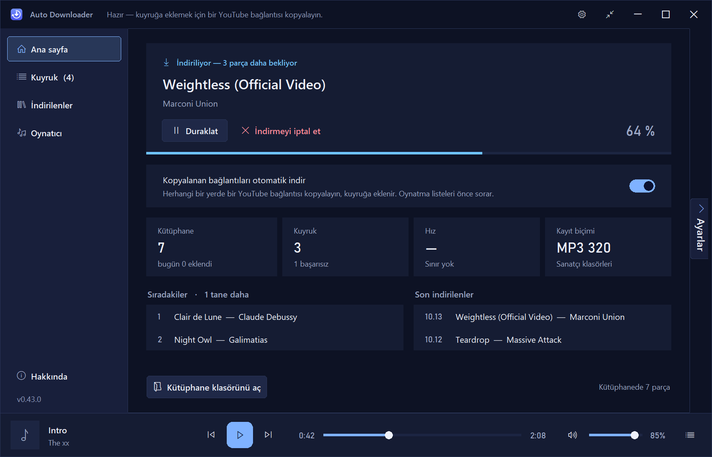
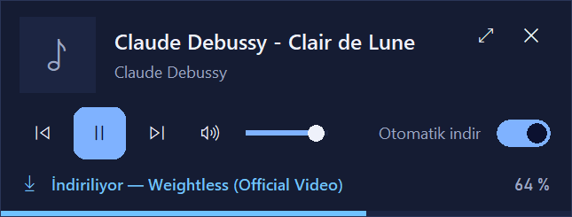
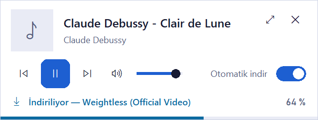
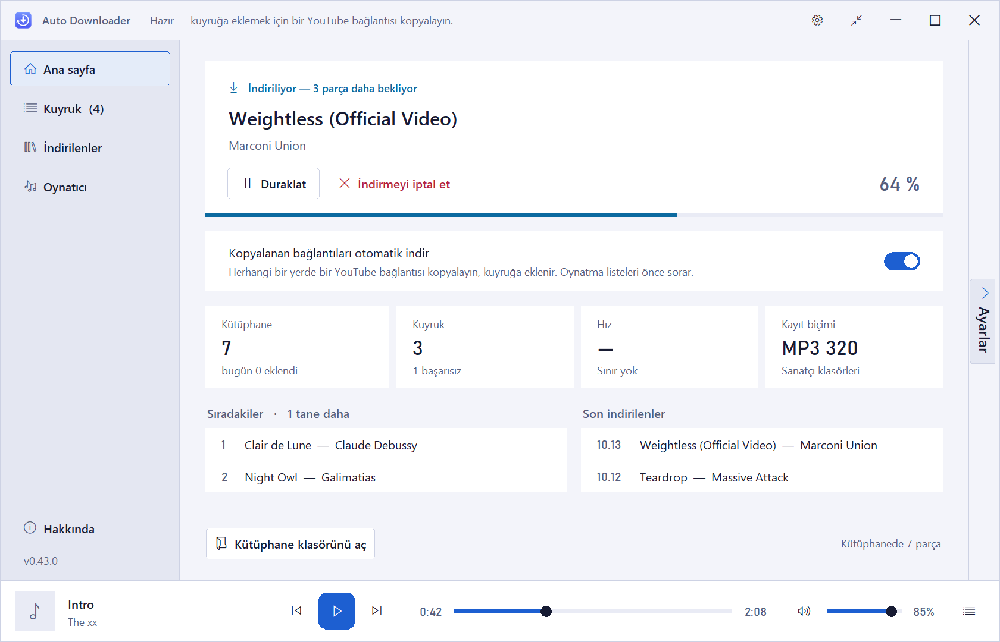
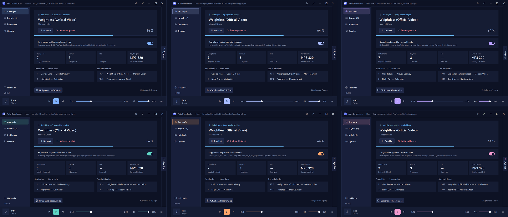
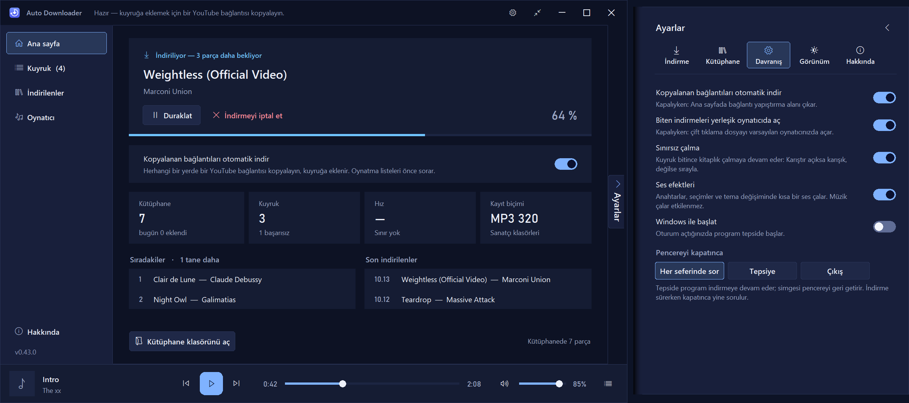
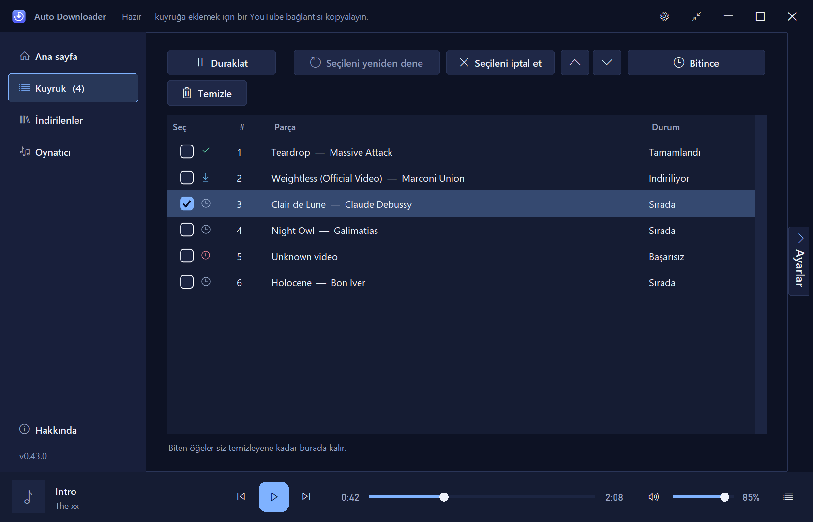
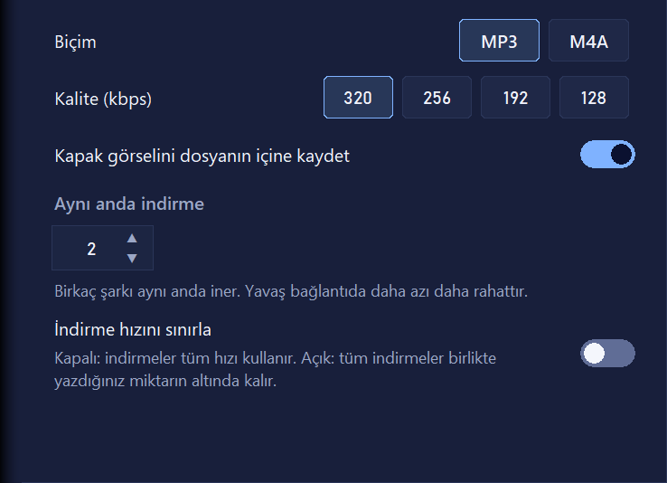
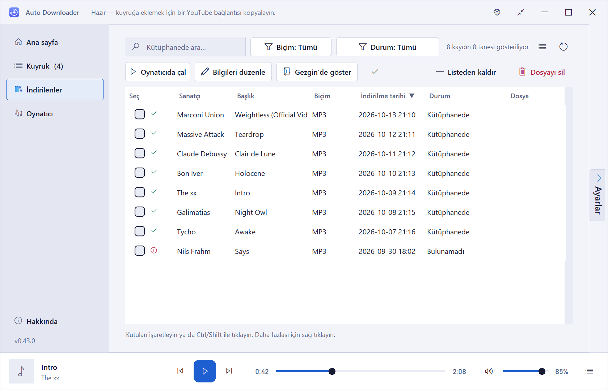
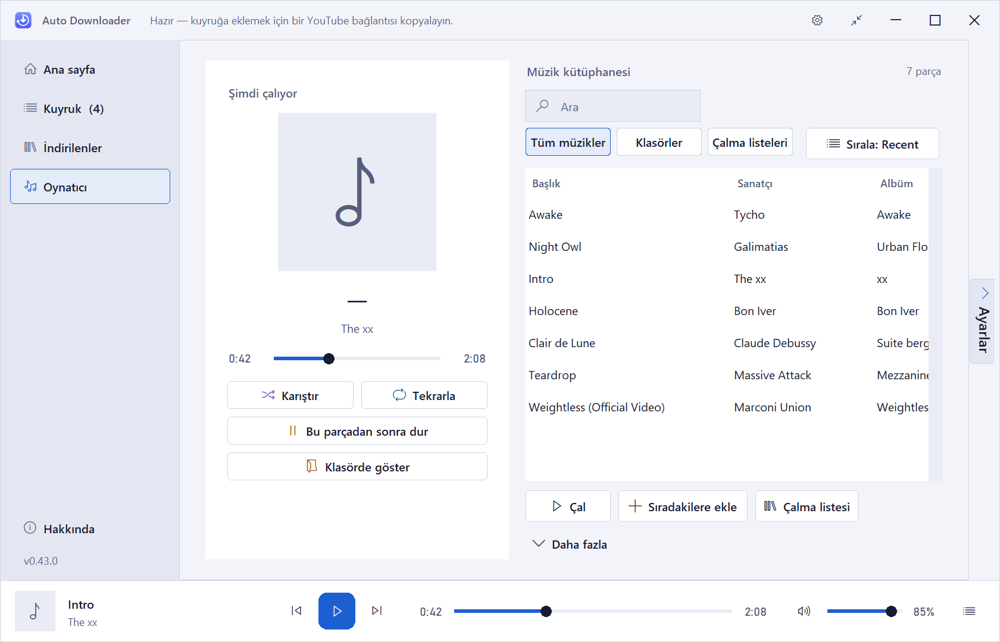

# Auto Downloader

**Bir bağlantı kopyalayın. Şarkıyı alın.**

Panonuzu izleyen ve kopyaladığınız YouTube bağlantılarını etiketli MP3 veya M4A olarak doğrudan kütüphanenize indiren bir Windows masaüstü uygulaması. DJ’ler ve koleksiyoncular düşünülerek tasarlandı.

[English](README.md) · **Türkçe**

[**⬇ En son sürümü indir**](../../releases/latest)

---

## Nasıl çalışır?

1. **Kopyalayın:** Bir YouTube bağlantısını herhangi bir tarayıcıdan, sohbetten ya da nottan kopyalayın.
2. **Kuyruğa girer:** Parça kuyruğa eklenir ve arka planda iner. Kısa bir ses bunu onaylar.
3. **Kütüphanede:** Etiketli ve kapak resimli MP3 veya M4A klasörünüze düşer; *İndirilenler* ve *Oynatıcı*’da görünür.

Ziyaret edecek site yok, başında beklenecek dönüştürücü yok.

## Öne çıkanlar

### Otomatik indirme
- Kopyalanan YouTube bağlantısı kendiliğinden kuyruğa girer ve iner.
- Oynatma listesi bağlantıları önce bir parça seçici açar; neyi istediğinizi siz seçersiniz.
- Kütüphanenizde ya da kuyruğunuzda zaten olan parçalar tanınır ve atlanır; aynı şarkı iki kez inmez.

### Pencere değiştirmeden indirin
- Uygulama bağlantıları arka planda yakalar; öne gelmesi gerekmez.
- **Mini görünüm:** çalan parçayı, indirme ilerlemesini, otomatik indirme anahtarını ve sesi gösteren, her zaman üstte duran küçük bir oynatıcı.
- Pencereyi kapatınca uygulama tepsiye gidebilir, indirmeler sürer.
- Başka bir programdayken medya tuşları çalmayı yönetir.

  
  &nbsp;
  

### Açık ve koyu tema, kendi renginiz, kendi diliniz
- Açık, koyu ya da Windows’u izleyen tema.
- Altı vurgu rengi.
- On arayüz dili: Türkçe, İngilizce, Felemenkçe, Almanca, Rusça, Arapça, Çince, Hintçe, İspanyolca ve Portekizce.

  
  &nbsp;
  

  

### Ayar çekmecesi
Pencere kenarındaki *Ayarlar* sekmesinden ya da başlık çubuğundaki dişliden açılır. Değişiklikler anında uygulanır, `Esc` kapatır.

  

### Kuyruk
- Aynı anda 1 ile 10 arası indirme (varsayılan 2).
- Duraklat, sürdür, başarısız parçaları yeniden dene, bekleyenleri yeniden sırala.
- Tüm indirmelerin paylaştığı isteğe bağlı hız sınırı.
- *Bitince:* bilgisayarı uyut ya da kapat, uygulamayı kapat veya tepsiye gönder.
- Uygulamayı kapatmak kuyruğu boşaltmaz; yarım kalan indirmeler bir sonraki açılışta devam eder.

  

## DJ’ler ve koleksiyoncular için

Etiketli ve düzenli, düz **MP3** ve **M4A** dosyaları.

- **Kaliteyi siz seçersiniz:** 320, 256, 192 ya da 128 kbps. Kapak resmi dosyaya gömülebilir.
- **Etiketler dosyayla birlikte gider:** başlık, sanatçı, albüm, yıl ve tür dosyanın kendi etiketlerinde durur ve uygulamada düzenlenebilir. İsteğe bağlı olarak “Sanatçı - Başlık” dosya adına ve başlık etiketine yazılır.
- **Klasör yapısı sizde:** tek klasör, sanatçıya göre, tarihe göre, sanatçı sonra tarih ya da tarih sonra sanatçı. Tek bir düğme mevcut dosyalarınızı yeniden düzenler.
- **Arayabileceğiniz, sıralayabileceğiniz, sürükleyebileceğiniz bir kütüphane:** biçime ve duruma göre süzün, parçaları başka programlara sürükleyin, kopya yok.
- **Parçaları dinleyip seçmek için oynatıcı:** tüm müzikler, klasörler ya da çalma listeleri; sıradakiler; karıştır, tekrarla, bu parçadan sonra dur, sınırsız çalma; medya tuşları.

  

  
  &nbsp;
  

> Ekran görüntülerindeki parçalar örnek veridir.

## Kurulum

1. [**Releases**](../../releases) sayfasını açın ve en son sürümdeki Setup `.exe` dosyasını indirin.
2. Çalıştırın ve kurulum sihirbazını izleyin. Uygulamanın ihtiyaç duyduğu her şeyi (FFmpeg ve diğer bileşenler) içerir.
3. **Auto Downloader**’ı başlatın. İlk açılışta dilinizi ve temanızı seçin.

**Windows SmartScreen:** Kurulum dosyası kod imzalı değildir, bu yüzden Windows “Bilgisayarınız korundu” uyarısı gösterebilir. Dosyayı bu deponun Releases sayfasından indirdiyseniz **Ek bilgi → Yine de çalıştır** seçeneğini kullanın.

**Gereksinimler:** Windows 10 veya üzeri (Windows 10’da geliştirildi ve denendi).

## Sorumlu kullanım

Auto Downloader kişisel bir araçtır. Yalnızca indirme hakkınız olan içerikleri indirin; kullandığınız hizmetlerin şartlarına ve sanatçıların haklarına saygı gösterin. Nasıl kullandığınızdan siz sorumlusunuz. Bu proje YouTube veya Google ile bağlantılı değildir ve onlar tarafından onaylanmamıştır.

## Üçüncü taraf bileşenler

Auto Downloader, [yt-dlp](https://github.com/yt-dlp/yt-dlp), [FFmpeg](https://ffmpeg.org) ve diğer açık kaynaklı bileşenleri kullanır. Ayrıntılar için [THIRD_PARTY_NOTICES.md](THIRD_PARTY_NOTICES.md) dosyasına bakın.

## Lisans

© 2026 ofbyz. **Tüm hakları saklıdır.** Bu depo yalnızca belgeleri ve yayın dosyalarını (binary) içerir.

## Destek

Auto Downloader işinize yarıyorsa ve geliştirilmesine destek olmak isterseniz bana Instagram’dan yazın: [**@ofbyz**](https://www.instagram.com/ofbyz).

Hata bildirimleri ve fikirler [Issues](../../issues) bölümünde memnuniyetle karşılanır.
